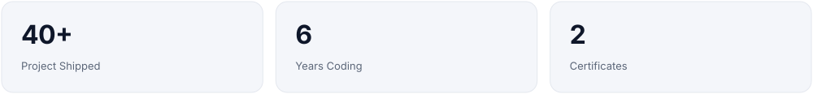
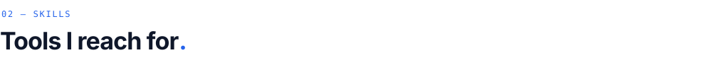

<!-- Panels are generated by scripts/build-assets.mjs — edit the content there, then run `node scripts/build-assets.mjs`. -->

<a href="https://arnchristian-portfolio.vercel.app">
  <picture>
    <source media="(prefers-color-scheme: dark)" srcset="./assets/hero-dark.svg" />
    
  </picture>
</a>

 

<picture><source media="(prefers-color-scheme: dark)" srcset="./assets/h-about-dark.svg" /></picture>

I love turning ideas into working software, whether that's a web app, a mobile app, or a side experiment. I like figuring out how things work, then building something new with what I learn. Outside of code, I game and watch anime.

<picture>
  <source media="(prefers-color-scheme: dark)" srcset="./assets/stats-dark.svg" />
  
</picture>

 
 

<picture><source media="(prefers-color-scheme: dark)" srcset="./assets/h-skills-dark.svg" /></picture>

<picture>
  <source media="(prefers-color-scheme: dark)" srcset="./assets/skills-dark.svg" />
  
</picture>

 
 

<picture>
  <source media="(prefers-color-scheme: dark)" srcset="./assets/contact-dark.svg" />
  
</picture>

  
  

