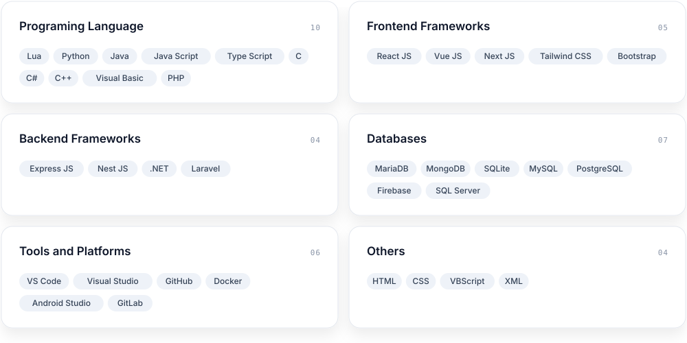
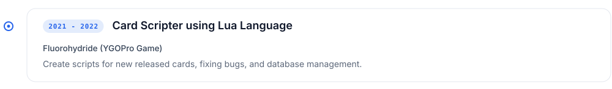
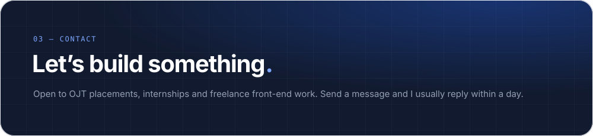

<!-- Panels are generated by scripts/build-assets.mjs — edit the content there, then run `node scripts/build-assets.mjs`. -->

<a href="https://arnchristian-portfolio.vercel.app">
  <picture>
    <source media="(prefers-color-scheme: dark)" srcset="./assets/hero-dark.svg" />
    
  </picture>
</a>

  
  
  

  
  
  
  
  

 

<picture><source media="(prefers-color-scheme: dark)" srcset="./assets/h-about-dark.svg" /></picture>

I love making all sorts of ideas happen by coding, whether it is web application development, creating a mobile application, or even testing out some other project.

My ideas sometimes arise out of the blue or are inspired by whatever I happen to come across. I also like gaming and watching anime. Gaming and anime may inspire my creativity and help generate ideas as well.

I'm always very eager to figure out how everything works and try to create something new and cool using all that I learn.

<picture>
  <source media="(prefers-color-scheme: dark)" srcset="./assets/stats-dark.svg" />
  
</picture>

 
 

<picture><source media="(prefers-color-scheme: dark)" srcset="./assets/h-skills-dark.svg" /></picture>

<picture>
  <source media="(prefers-color-scheme: dark)" srcset="./assets/skills-dark.svg" />
  
</picture>

 
 

<picture><source media="(prefers-color-scheme: dark)" srcset="./assets/h-experience-dark.svg" /></picture>

<picture>
  <source media="(prefers-color-scheme: dark)" srcset="./assets/experience-dark.svg" />
  
</picture>

 
 

<picture><source media="(prefers-color-scheme: dark)" srcset="./assets/h-activity-dark.svg" /></picture>

  <picture>
    <source media="(prefers-color-scheme: dark)" srcset="https://github-readme-stats.vercel.app/api?username=ArnChristian07&show_icons=true&border_radius=16&bg_color=111a2c&border_color=1e2a40&title_color=e7ecf4&text_color=c3ccda&icon_color=4f8cff&ring_color=4f8cff&rank_icon=github" />
    
  </picture>
  <picture>
    <source media="(prefers-color-scheme: dark)" srcset="https://github-readme-streak-stats.herokuapp.com/?user=ArnChristian07&border_radius=16&background=111a2c&border=1e2a40&ring=4f8cff&fire=4f8cff&currStreakNum=e7ecf4&currStreakLabel=4f8cff&sideNums=e7ecf4&sideLabels=c3ccda&dates=94a0b4" />
    
  </picture>

<picture>
  <source media="(prefers-color-scheme: dark)" srcset="https://raw.githubusercontent.com/ArnChristian07/ArnChristian07/output/github-contribution-grid-snake-dark.svg" />
  
</picture>

 
 

<a id="-contact" href="mailto:arnchristian3535@gmail.com">
  <picture>
    <source media="(prefers-color-scheme: dark)" srcset="./assets/contact-dark.svg" />
    
  </picture>
</a>

  
  
  

